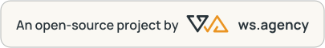

# Artefacts67

[](https://ws.agency/)

Publishing **private-by-default, self-contained HTML artefacts and applications**. Complete-document
`site` publishing remains the default and compatible format; optional `page` artefacts are validated
fragments rendered with checked platform themes. Ordinary links require authorized sign-in;
external readers use deliberately created visitor shares, with an optional share password.
Applications keep encrypted personal and shared data outside the console session.

The platform is a **Cloudflare Worker** (D1 for state, R2 for sealed content, one Durable Object for
strongly-consistent counters). You run your own instance: see [First deploy](#first-deploy).

- **Source:** [github.com/wsagency/artefacts67](https://github.com/wsagency/artefacts67) (MIT).
- **Documentation:** `/instructions` on your instance documents the platform for people and AI.
  **Console:** `/app`. **AI briefing:** `/llms.txt`. **Agent contract:** `/_api/contract`.
- **Bindings:** Worker `artefacts67`, D1 `artefacts67` (binding `DB`), R2 `artefacts67` (binding
  `ARTIFACTS`), `RateLimit` Durable Object (binding `RATELIMIT`), `ASSETS` (console bundles,
  favicon and logo).

## How it works

- **Private by default, including existing artefacts.** Ordinary artefact URLs, folder indexes,
  ids and retired paths require a current signed-in account with completed second-factor
  authentication and current read authority. Owners and explicitly granted colleagues can read;
  platform staff roles do not grant access to another estate. Anonymous reading requires an
  active visitor share. Publishing, copying an ordinary link, clearing a password or duplicating
  without one never grants public access. See [ADR 0031](dev-docs/decisions/0031-private-by-default-artefacts.md).
- **Every artefact is encrypted on the server.** Content is sealed in R2; the Worker uses its
  master-key wrap for authorized previews and explicitly authorized passwordless shares.
  An optional document password adds a password-derived wrap and an additional gate to an
  already-authorized ordinary link. `POST /_gate/<path>` requires current signed-in read access
  before verifying that password or releasing wrapped keys and ciphertext. The Durable Object
  enforces lockout; the browser unwraps and decrypts after acceptance. A document password
  alone never grants anonymous access. Password rotation re-wraps one row, not the document.
- **New passwordless shares** can explicitly authorize protected content. After checking the
  share's live scope, expiry and revocation, the Worker decrypts through its master-key wrap
  and releases the document to the same sandboxed viewer. This visitor path is not password-derived or server-blind. Password-bearing
  shares retain their own gate and browser-side key chain; existing passwordless grants are
  not expanded. See [ADR 0027](dev-docs/decisions/0027-optional-share-passwords-and-bearer-access.md).
- **Links retain their identity, not anonymous access.** An artefact answers on its slug
  (`/<slug>/`), or on its 80-bit id until named. Renames and imported 1.x paths remain aliases
  under the same current access checks. Deletion withdraws content and reserves its paths.
  Unknown or unauthorized ordinary paths answer the same neutral page without disclosing
  titles, folder contents or document material.
- **Folders group artefacts** (a client, a project, or another owner-defined container).
  Use **New folder** in `/app` or **New top folder** at the bottom of the sidebar to create an
  empty top-level folder. Click a folder's icon/name to expand or collapse it; its gear opens
  role-aware resource tabs. The small **+** immediately left of the gear opens the child-folder
  name dialog; **Escape** cancels without creating anything. Publish artefacts through the
  folder's **Overview** or the command palette. Lock icons open **Password** options:
  an artefact's additional authorized-link gate, or a folder's independent visitor-share passwords.
  Move artefacts or owned folders using the tree or their settings forms. Organization does
  not change existing links. An owner deletes a folder with everything in it (subfolders,
  artefacts, project data) from its **Settings → Delete folder** by typing the folder's name; at
  most 200 artefacts and 100 folders go per deletion, so delete a larger tree bottom-up. Visitor
  shares and colleague access end, every path stays reserved and never resolves again, and the
  daily cleanup removes the stored bytes (ADR 0038).
  Colleague grants follow the current folder tree; visitor shares can cover one artefact or
  the current subtree of a top-level folder.
- **One hostname, isolated execution.** The console and viewer stay on the existing domain.
  Authored HTML runs in an opaque `sandbox="allow-scripts"` iframe, never with
  `allow-same-origin`. Complete documents retain native `DOMContentLoaded`/`load` behavior,
  and their CSS and JavaScript are not extracted into the console. Browser storage is deliberately
  unavailable in this model; `window.artefacts.storage` provides authorized asynchronous persistence.

- **Site and page artefacts.** Existing publishes and requests that omit `type` remain `site`:
  complete HTML documents with their established source bytes and analytics behavior. Opt into
  `type: "page"` for a fragment with a constrained HTML/SVG/CSS grammar, a checked platform theme,
  and a sandboxed composed viewer. The site path is unchanged. Browse the checked themes at
  `/themes`; the write API accepts `{ "scope": "platform", "slug": "report" | "editorial" | "launch" }`
  as `theme`, with optional validated `themeOverrides` for page-only customization. Page fragments
  retain local `#id` navigation. The toolbar's Copy HTML action returns the authored source. For
  pages with a registered theme, Download HTML composes a standalone document with the trusted
  inline kit, selected theme, runtime, and CSP; an unregistered theme slug falls back to `report` in
  the viewer and leaves the downloaded page as the authored fragment. Composed downloads omit the
  hosted SDK, live persistence, and application data. See the [contract](dev-docs/artefact-contract.md)
  for the accepted grammar and security boundary. The `/themes` gallery compares all three checked
  themes on one common sample; it does not publish pages or expose a design editor. The page
  runtime does not permit external scripts, stylesheets, images or network requests.
  Fragment-only links stay inside the document and preserve its form and JavaScript state.
  The automated page accessibility gate audits shipped experiences against WCAG 2.2 A/AA rules;
  axe incomplete findings are reported separately, and this is not a certification of arbitrary
  authored content.
- **Fonts are captured when publishing.** Supported Google Fonts stylesheets and font files are
  downloaded, checked and embedded in the encrypted document. Visitors do not contact the font
  provider, and a failed capture rejects publication rather than silently changing typography.
- **Application data is independent of source versions.** Personal values belong to one artefact
  and reader; shared values are readable by authorized readers and writable by current
  editors/managers/owners. Visitor shares never grant shared-write authority. Duplication starts
  with empty application data, restoration appends a source version without rolling data back,
  and deletion removes both content and application data. Project collections can hold files
  (`file` fields, ≤100 MiB, resumable, sealed per part; ADR 0035).

## Surfaces

| Surface | Where | Who |
|---|---|---|
| Private viewer + optional additional gate | `/<folder>/`, `/<slug>/`, `POST /_gate/<path>` | current authorized signed-in readers |
| Solid 2 console | `/app` (estate and folders), `/settings` (account, security, API keys), `/admin` (users, platform, reports — owner/admins) | platform users (Owner / Admin / Member) |
| Visitor share | `/<target>/s/<token>/` | anyone holding an active share link, and its password when required |
| Observations | `POST /_ev` | the share viewer, with a short-lived authorized opening proof |
| Write API | `/_api/*` | agents, with a `wak_` master key or a `waa_` artefact key |
| MCP | `POST /_mcp` | agents, with a `wak_` master key; authorized `waa_` keys may call `get_artifact` |
| Documentation | `/instructions` — features, workflows, permissions, API reference and copyable AI instructions | public |
| Root | `/` — redirects to sign-in or the console | public |
| AI briefing | `GET /llms.txt` — the same agent instructions as plain text, without credentials | public |
| Contract | `GET /_api/contract` — the canonical API, validator, storage, project data and files SDK reference | public |

Every reader uses the same compact toolbar based on Claude's authenticated artefact viewer:
the Artefacts67 mark (a link home) and the artefact's grouped title menu on the left; Preview/Code, Share, Download and
Fullscreen icons on the right, including narrow viewers. Share distinguishes a **private link**
requiring authorized sign-in from an existing **visitor-share link**. Managers create external
access through visitor-share management; copying a private link never grants it.
Download saves authored complete-document source for a `site`; for a `page` with a registered theme,
it composes the fragment as a standalone HTML document with the trusted inline kit, selected theme,
runtime, and CSP. An unregistered theme slug renders with the `report` fallback but downloads as the
authored fragment. Composed page downloads exclude the hosted SDK, live persistence, and application
data. The title menu's Copy HTML action always returns the authored source (a fragment for a page);
it also retains refresh, reporting and authorized version history, rename, resource settings and
deletion. Switching to Code preserves the running preview; source operations use the same live
access checks as downloading.
Share analytics remain private.
An artefact that declares `<meta name="color-scheme" content="light dark">` also gets a
light/dark switch in the toolbar: it starts from the reader's system preference, remembers an
explicit choice in that browser for every artefact, and applies it live without reloading the
artefact (contract §6 "Light and dark"). Artefacts without the declaration get no switch.

The sidebar's **Search** opens the command palette, also available through **Ctrl+K** or
**Cmd+K**, including while an artefact's iframe has focus. **Win/Meta+K** also works when the
desktop passes that shortcut to the browser. Search authorized folder/artefact names and
folder paths; use arrow keys and Enter to navigate. **Create new top folder**, **Create folder**,
**Create artefact**, and **Share** use the positioned resource: nested creation uses the
selected folder or the selected artefact's folder, and Share opens existing sharing options
without granting access automatically. Position is retained across same-route form responses.
The sidebar footer's **Copy AI prompt** button fetches `/llms.txt` and copies the agent instructions
to the clipboard, with an accessible success or failure announcement.

`/instructions` documents the platform for people and agents. `DESIGN_TEMPLATE_URL` optionally
names a fallback design template that agents use when the user has not specified a design.

An artefact is either a complete self-contained `site` HTML document or an opt-in `page` fragment.
Both keep their presentation inline and may use local navigation. Page Copy HTML returns the raw
fragment. With a registered theme, Download HTML composes a page into a standalone document with
the trusted kit, selected theme, runtime and CSP; an unregistered theme slug renders with the
`report` fallback but downloads as the authored fragment. Composed page downloads omit the hosted
SDK, live persistence and application data. Publication accepts no asset uploads, bundles,
separately hosted subpages, or cross-links to other artefact URLs; project files are application
data in collection `file` fields, not page assets. Application storage is encrypted JSON key/value
data through the hosted SDK, not a SQL database.

The write API publishes **synchronously**: `POST /_api/artifacts` upserts on `(folder, slug)` and
answers `201`/`200` with the artefact already live. A master key can also mint, rotate and revoke
per-artefact keys, record retired paths, and — deliberately, per request — accept a password below
the eight-character floor that guards unattended agents.

Artifact keys can opt into `can_read_content` when created; unchecked or omitted values, including
for existing keys, are false. Key rotation preserves the capability. The HTTP content-read route
and MCP `get_artifact` require the opt-in plus current read authority (and `read` scope for artifact
keys), and audit each outcome without storing source content. Password-gated content does not
require its password for an authorized key; passwords and visitor shares alone do not grant API/MCP
read authority. Publish and rotate-with-HTML accept optional `ifVersion`: stale writes conflict and
concurrent losing content is cleaned up; omission retains unconditional behavior. M2 additionally
supports optional `page` artefacts and checked platform themes; `site` remains the default. The
`/instructions` and `/llms.txt` publishing guidance continues to recommend complete-document
`site` output until M4's human assistive-technology sign-off; conditional console form tokens are
not shipped.

## Native navigation regression check

For the native navigation regression check, publish
[`worker/test/fragment-navigation.html`](worker/test/fragment-navigation.html) through the
console or write API and open its preview. It must show **PASS** after jumping to the charging
section, with the edited price retained. It exercises the real opaque iframe without a DOM mock
or an additional test framework.

## Sharing and collaboration

Open a folder's gear in `/app` to manage **Colleague access**. Enter an existing active
platform user's exact email address and choose a role:

| Folder role | Capabilities |
|---|---|
| Viewer | Read and open the authenticated preview |
| Editor | Viewer access, plus publish, create children, edit metadata/passwords/paths and move artefacts within the owner's estate |
| Manager | Editor access, plus visitor shares and detailed analytics |
| Resource owner | All of the above, plus colleague grants, folder moves and deleting a folder with its contents |

Grants apply to descendants and the strongest applicable role wins. A direct grant can be
removed without removing an inherited one. Newly created children belong to the folder's
owner, not the colleague who published them. Platform Owner/Admin status is not a grant to
someone else's content. API keys recheck the same current permissions on every request.
Shared folders appear under **Shared with you**. Click an artefact's name to read it in the
main pane while keeping the sidebar. The external-link icon beside the name or in the reader
header opens it in a separate tab; the gear opens its settings. Both reading modes use the
authenticated preview and isolate document scripts from the console session.

On desktop, hover a tree row or focus it with the keyboard to reveal its lock, open, settings,
and child-folder actions. At rest, names use that space instead. Touch devices keep actions
visible; read-only password-protection indicators remain visible on every device.

The sidebar's chevron collapses or restores it. On desktop, drag its right edge to resize it,
or focus the edge and use the arrow keys (Home/End select the width limits). Width and collapse
state are remembered in this browser; on narrow screens the sidebar becomes a collapsible header.

Beside the S/M/L text-size controls, choose **Original** (warm-neutral sidebar), **Light** (white
sidebar), or **Calm** (muted sage and warm neutrals). Theme and text size are remembered
independently in this browser. Themes change only the console chrome: authored documents
and visitor share pages retain their own styling.

An artefact's settings are grouped into **Overview**, **Content & versions**, **Password**,
**Sharing**, **Analytics**, and **Links**. Only tabs allowed by your current role appear.
The selected tab is linkable and survives form responses and reloads; arrow keys navigate
the tab row.

Use **Sharing → Visitor shares** on an artefact, or **Visitor shares** on a top-level folder,
to create a named link. **Name** is required and can describe a person, group or purpose;
**Recipient email** is optional unless you select email delivery. The name and any email
are sealed at rest and visible only to authorized managers, not visitors. Existing email-only
shares keep their URLs and observations, with their former email used as their display name.
Expiry defaults to 30 days, with a 365-day maximum. **Password is always optional for a new
share**, independently of the artefact's ordinary password. Leaving it blank shows a warning:
anyone who has or receives the link can read its contents, including protected artefacts and
future descendants of a shared folder. The link is not publicly listed, but can be forwarded.
The ordinary link remains private, with an additional document gate when configured.

The authorization choice, legacy migration and server-decryption trade-off are recorded in
[ADR 0027](dev-docs/decisions/0027-optional-share-passwords-and-bearer-access.md), which partially
supersedes the visitor-password rules in ADRs 0014, 0020 and 0026.
Existing passwordless shares retain their original exclusion of protected contents;
create a new link to deliberately grant broader access.

Copy the link yourself, or explicitly tick the email checkbox; email never includes the
password. Unconfigured/dry-run or failed mail is reported without losing the created link.
Revoking a share stops subsequent requests through that link; private ordinary access and other
shares remain independent, and already downloaded content cannot be recalled.

The artefact's **Analytics** tab includes a **By share link** table, labelled with your share
names, alongside overall opens, estimated active reading time, scroll-depth buckets and daily
trends. **Folder statistics** combines its authorized subtree. Counts are attributed to links,
not identified or unique people: a group's members all contribute to the same named share.
Only resource owners and managers see this detail. `/admin` shows platform-wide counts and
trends without recipients or content. The platform owner sets observation retention at
`/admin/settings`: 90 days by default, adjustable from 1 to 365. Expired rows are deleted daily;
reducing retention prunes immediately. Private ordinary links, internal previews and folder
index views are not measured. Measurements contain no IP, user agent, document text or input,
and blocked scripts or forwarded links mean these are usage estimates, not proof of reading.

## Operating it

Use Node.js 24 LTS for CI parity (Node.js 22.12+ is supported). Install each package's locked
dependencies with `npm ci`, `npm ci --prefix worker` and `npm ci --prefix frontend`.
`npm run build` generates the API contract module and builds the Solid 2 RC.20 / owned
SolidUI / Tailwind assets into `frontend/dist`. The strict TypeScript packages use TypeScript 7;
`frontend/src/vite-env.d.ts` declares CSS imports. `npm run typecheck` checks both packages;
`npm test` runs the Worker suites. Wrangler's custom build runs the same frontend build for
development and deployment. Development watches Worker, frontend, static asset and contract
sources; unchanged generated contracts are not rewritten, avoiding rebuild loops.

Console/auth navigation and form mutations reuse authorized HTML bootstraps without
a full document reload. Reader metadata, sidebar moves/subfolders, and Preview/Code
preserve the running artefact iframe; explicit refresh and source changes may reopen it.
Each accepted navigation or form submission owns its response immediately: stale
mutation responses cannot replace a newer screen, even during a same-URL refresh or
after navigating away and back. The sidebar defaults to 240px with compact rows and
controls; saved widths, text sizes, themes, collapse state and keyboard resizing remain.
Public guides, downloads, external links, and new-tab links retain native navigation.
SolidUI components are locally owned Solid 2 ports: upstream Kobalte still requires
Solid 1, so incompatible peer dependencies are not forced into this build (ADR 0030).

The actual-Chrome reader regression check requires a dedicated local artefact whose
title contains `Solid 2 smoke`, with a retained version older than its live version.
It changes that fixture's title, restores an older source as a new version, and checks
rejected share validation, focus, source-mode state, stale-response ordering, and
refreshable GET URLs. It then publishes `smoke-project/smoke-rsvp` through `POST /_mcp`,
defines a `rsvp` responses collection, and checks native form submission inside the
sandbox (invalid-required focus, Enter, `requestSubmit()`, a lone-field form) and the
stored response, then deletes the records and the collection. It then exercises project files
(ADR 0035): it defines `assets` and `client-library` (records) and `uploads` and `client-files`
(responses),
uploads a PNG with a non-ASCII name over MCP and the API part path, shows it in the frame with
`file()`, saves it through `download()`, submits a 30 MiB file and a small one from a form with
a reload before the big file's second part and a resume that skips the acknowledged part,
checks both files' bytes over the API, aborts an upload (one `upload-cancel`, no part sent), and
has a signed-out share visitor submit a file (and be refused a records upload). It then deletes
the records, collections, share and artefacts. A run interrupted before that cleanup can leave
upload sessions open for up to 24 h (five per reader). Supply its reader URL, the `wsa_session`
cookie value for the collaborator, Chrome executable, a local content-read `wak_` master key, and
a separate key without `can_read_content` (a `wak_` master or a fixture-scoped `waa_` key);
never use production credentials. Use a collaborator session with no master key and manager access
to the fixture folder; both API keys belong to the fixture owner.
With the collaborator session above, `WS_SMOKE_OWNER_SESSION` is required: it is the owner's local
session cookie used only for cleanup of artefacts created through the master key. Omit it only
for same-owner runs, where cleanup uses `WS_SMOKE_SESSION`:

```sh
WS_SMOKE_VIEWER='http://localhost:8788/app/a/<smoke-slug>/view' \
WS_SMOKE_SESSION='<local-collaborator-session-cookie>' \
WS_SMOKE_OWNER_SESSION='<local-owner-session-cookie>' \
WS_SMOKE_CHROME='<Chrome executable>' \
WS_SMOKE_API_KEY='<local content-read wak_ master key>' \
WS_SMOKE_NOREAD_API_KEY='<local key without can_read_content>' \
node frontend/scripts/smoke-reader.mjs
```

For isolated local development, put a development-only master key in `worker/.dev.vars`, apply
the local migrations and start Wrangler on the reserved smoke port (Wrangler persists to
`worker/.wrangler/state`):

```sh
echo "ARTEFACTS_MASTER_KEY=$(openssl rand -hex 32)" > worker/.dev.vars
npm run migrate:local
npm --prefix worker exec -- wrangler -c worker/wrangler.jsonc dev --port 8788
```

The public `worker/wrangler.jsonc` sets no vars, so `PUBLIC_ORIGIN` and `WEBAUTHN_RP_ID` derive
from the request (for example `http://localhost:8788`). Keep imported snapshots separate and select
their persistence root explicitly; never run root `npm run migrate` for local setup, because it
targets remote D1. Never reuse or regenerate a production master key for a smoke run.

- **Deploy:** see [First deploy](#first-deploy); later deploys are `npm run migrate` followed by
  `npm run deploy`.
- **Migrations always precede code.** New columns and tables arrive in `worker/migrations/`; the
  workflow applies them before deploying the Worker that needs them.
- **Secrets** (set with `wrangler secret put`, never in the repository): `ARTEFACTS_MASTER_KEY`
  (64 hex chars — it seals the metadata tier and wraps every content key, so losing or regenerating
  it makes every stored secret and every published artefact unreadable), and `SMTP_*` when platform
  mail should really send. Vars are listed under [Configuration](#configuration).
- **Health:** `GET /_health` probes D1, R2 and the Durable Object in one request and answers 503 with
  the failing check.
- **Backups:** D1 Time Travel covers the database automatically. R2 has no equivalent, so a scheduled
  export is the honest long-term answer (ADR 0023 records the current position).

## First deploy

1. `npm --prefix worker ci && npm --prefix frontend ci`, then `npx wrangler login` from `worker/`
   (or set `CLOUDFLARE_API_TOKEN` and `CLOUDFLARE_ACCOUNT_ID`).
2. `cd worker && npx wrangler d1 create artefacts67`. Creating the database first means the Worker
   never runs without a schema.
3. `npx wrangler d1 migrations apply DB --remote`
4. `npx wrangler deploy`. It connects D1 by name, provisions the `artefacts67` R2 bucket, and
   publishes on workers.dev.
5. `openssl rand -hex 32 | npx wrangler secret put ARTEFACTS_MASTER_KEY`. Until this step the
   platform routes answer 500 while `/instructions` already renders. Losing this key makes every
   stored secret and artefact unreadable.
6. **Immediately** after step 5, open `/register` and create the platform owner, before sharing the
   URL with anyone. `/register` is open to whoever arrives first until one account exists: the first
   account becomes the platform owner, `/login` redirects to `/register` while the platform has no
   users, and `/` redirects to `/login`. The window opens at step 5 (before it, `/register` answers
   500), and the workers.dev hostname is predictable (`artefacts67.<subdomain>.workers.dev`).
7. Optionally put `SMTP_*` secrets. If the instance gets a custom domain, set `PUBLIC_ORIGIN` and
   `WEBAUTHN_RP_ID` as vars. Otherwise both are derived from the first request the isolate serves,
   so one host per instance is the supported setup.

## Configuration

Vars go in `worker/wrangler.jsonc` (`"vars"`) or the Cloudflare dashboard; secrets go through
`wrangler secret put`. Everything except `ARTEFACTS_MASTER_KEY` is optional.

| Name | Kind | Meaning |
|---|---|---|
| `ARTEFACTS_MASTER_KEY` | secret | 64 hex chars; required for every platform route |
| `PUBLIC_ORIGIN` | var | Canonical origin, for example `https://artefacts.example.com`; default: the request's origin |
| `WEBAUTHN_RP_ID` | var | Passkey relying-party id (the hostname); default: the request's hostname |
| `WEBAUTHN_RP_NAME` | var | Name shown by passkey prompts; default `Artefacts67` |
| `OPERATOR_NAME` | var | Adds a "Hosted by …" line to the documentation and sign-in screens |
| `DESIGN_TEMPLATE_URL` | var | Fallback design template named in `/instructions` and `/llms.txt`; omitted when unset |
| `LEGACY_HOSTS` | var | Comma-separated hosts that answer 308 to the same path on `PUBLIC_ORIGIN` |
| `WEB_ANALYTICS_TOKEN` | var | Cloudflare Web Analytics token; console and sign-in pages load the beacon only when set |
| `GATE_THRESHOLD` | var | Wrong passwords before a pair locks; default 4 |
| `GATE_LOCK_SECONDS` | var | How long a locked pair stays locked; default 3600 |
| `SMTP_HOST`, `SMTP_PORT`, `SMTP_USER`, `SMTP_PASS` | secrets | Enable invitation and share e-mail |
| `SMTP_FROM` | var | Fallback sender; the platform owner sets the real From address in `/admin/settings` |

## Repository layout

```
worker/          the platform: src/, migrations/, test/, scripts/, wrangler.jsonc
frontend/        strict TypeScript Solid 2 console, owned SolidUI/Tailwind controls and trusted viewer/SDK adapter
assets/          favicon and static assets copied into frontend/dist by the build
scripts/         leak-check.sh, the publication leak check
dev-docs/        decisions (ADRs), research and the artefact contract
CONTEXT.md       the domain vocabulary — read before naming anything
CHANGELOG.md     what changed, per release
```
The established `/assets/ws-logo.svg` remains available to authored documents under the existing
content contract; the new product assets do not expand the authored-document asset whitelist.


## Documentation

- `CONTEXT.md` — the domain language (artefact, folder, gate, share, visitor, publish, …). Use its
  words in tickets, tests and code.
- `dev-docs/decisions/` — every load-bearing decision, as ADRs. The current set runs through 0037;
  the numbers have gaps, because ADRs 0001, 0008, 0022 and 0036 are not published. Read the ones
  touching what you are about to change.
- `dev-docs/artefact-contract.md` — the agent-facing artefact contract, served at `/_api/contract`;
  `worker/scripts/sync-contract.ts` generates the Worker's embedded copy during the build.

## Licence and trademarks

The software is MIT-licensed ([`LICENSE`](LICENSE)). [`TRADEMARKS.md`](TRADEMARKS.md) lists the
exclusions (brand artwork, the product logo and favicon, fonts and the design-kit CSS) and covers
the WS Agency and Artefacts67 marks.

**Rebranding:** replace `assets/ws-design-kit/products/` and `assets/favicon.ico`, drop the credit
(`frontend/src/auth.tsx`, `worker/src/instructions.ts`), and run `git grep -n Artefacts67` to find
the product-name strings.

## Contributing

Pull requests are welcome; we merge them into our upstream and publish them here with you credited as co-author, then close the PR with a link to that commit.
